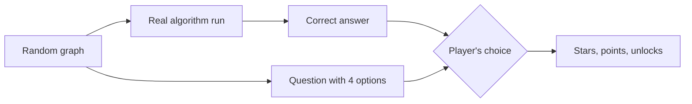
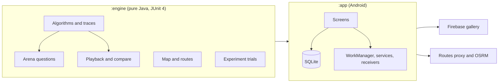

<p align="center">
  
</p>

<p align="center">
  
  
  
  
  <a href="https://github.com/Juairia2020/GraphLab/actions/workflows/engine-tests.yml"></a>
  
  
</p>

GraphLab is an Android app for learning, testing, visualizing, comparing and applying algorithms.
It looks like a puzzle game, but every answer is checked by a real algorithm engine.

## Features

| Tab | What it does |
|---|---|
| **Lab** | **Build** graphs with an editor (undo and redo, typed edge lists, photo import). **Run** any algorithm with step playback, a step log, state tables, pseudocode and an Insight page, and export the run as a PDF. **Compare** two algorithms side by side. **Experiment** repeats a randomized algorithm many times and draws a histogram. **Graphs** is the library: save, rename, share, import files, sample library and cloud gallery. |
| **Arena** | 34 activities, each a ladder of Easy, Medium and Hard questions with stars, points and unlocks. Includes Break the algorithm, Fog of war, a daily puzzle and a leaderboard. |
| **Toolkit** | Real-world scenarios on a map: route, round trip, network, flow, flood relief and bus network, with road distances. |
| **Me** | Theme (system, light, dark), daily reminder, cloud sharing, effects (glow, sound, haptics, reduced motion), lifecycle log. |

More:
- **Photo import**: take or pick a photo of a graph and GraphLab detects the nodes, edges and weights. You review the result before it opens in the editor.
- **Landscape mode**: the bars fold away so the graph gets the whole screen. Run keeps its playback and settings in slide-over panels.
- **Sounds** for correct and wrong answers, finished rounds, finished runs and finished experiments.
- **Cloud gallery**: publish a graph and open graphs from other players.

## Algorithms

<p align="center"></p>

Every algorithm produces a trace of steps. The screens only replay the trace, so the picture on the screen is
always what the algorithm really did.

<p align="center"></p>

## How it works





## Requirements

| Tool | Version |
|---|---|
| Android Studio | A stable release that supports AGP 9.4 |
| JDK | 17 or newer (the bundled one is fine) |
| Android SDK | Platform API 37, Build-Tools 36.0.0 |
| Gradle | 9.6.0 (downloaded by the wrapper) |
| Device | Emulator or phone, Android 8.0 (API 26) or newer |

Library versions are in `gradle/libs.versions.toml`.

## Run

1. Open the folder in Android Studio and wait for the Gradle sync.
2. Run the `app` configuration on an emulator or a phone.

Engine tests need no phone: `./gradlew :engine:test` (run `gradle wrapper` once to create the script).

GraphLab runs with no keys. These optional values go in `local.properties` (not tracked by Git; see `local.properties.example`):

| Key | Unlocks |
|---|---|
| `firebase.projectId`, `firebase.apiKey`, `firebase.appId` | Cloud gallery and player progress (rules in `docs/firestore.rules`) |
| `MAPS_API_KEY` | Google Maps on the Toolkit screen |
| `routesProxyUrl` | Road distances through `cloud/routes-proxy` (OSRM is the free fallback) |
| `sampleLibraryUrl` | A hosted `sample-library.json` (the app has a built-in copy) |

## Course coverage

### Algorithm topics

| Topic | Covered by |
|---|---|
| Graph traversal | BFS, DFS |
| Shortest paths | Dijkstra, Bellman-Ford, Floyd-Warshall, A* |
| Minimum spanning tree | Kruskal, Prim |
| Network flow and matching | Edmonds-Karp, Dinic, bipartite matching |
| Components and ordering | Tarjan SCC, topological sort |
| Greedy | Huffman, fractional knapsack, Kruskal, Prim |
| Dynamic programming | Coin change, edit distance, LCS, LIS, matrix-chain, 0/1 knapsack |
| Divide and conquer | Merge sort, quick sort, closest pair |
| Randomized algorithms | Randomized quick sort, quick select, Karger min cut, reservoir sampling, balls in bins, secretary problem |
| Graph colouring | Graph colouring |

### Android course checklist (17 of 17)

| # | Item | Where |
|---|---|---|
| 1 | Multi-activity app, explicit intents | `ui/common/BaseActivity.navigateTo`, the tab Activities |
| 2 | Implicit intents | `ui/common/GraphShare` (`ACTION_SEND`, `FileProvider`), `ACTION_OPEN_DOCUMENT` import |
| 3 | Lifecycle callbacks | `LabActivity`, `data/LifecycleLogger`, `LifecycleLogActivity` |
| 4 | XML layouts, ViewBinding, click listeners | `res/layout/*` |
| 5 | RecyclerView | `StepLogAdapter`, `NodeTableAdapter` (`ListAdapter`, `DiffUtil`) |
| 6 | Custom View | `ui/common/GraphView` |
| 7 | Mobile UX | Light and dark theme, edge-to-edge insets, 48 dp targets, empty states, swipe to delete with Undo |
| 8 | Service | `service/ExperimentService` (foreground service with notification actions) |
| 9 | BroadcastReceiver | `RunFinishedReceiver`, `BatteryStateReceiver`, `ConnectivityReceiver` |
| 10 | ContentProvider | `provider/GraphProvider`, client `CompareRunsActivity` |
| 11 | Permissions and component communication | `ui/me/ReminderController`, `work/Notifications` |
| 12 | HTTP and API requests | `data/net/HttpFetcher`, `data/cloud/OsrmClient` |
| 13 | JSON and XML parsing | `engine/io/MiniJson`, `GraphJson`, `GraphMl` |
| 14 | Database | `data/db/GraphDb`, `GraphRepository` (SQLite) |
| 15 | Background operations | `AppExecutors`, `LabViewModel.startRun`, `ExperimentService` |
| 16 | Advanced API | `work/ReminderScheduler`, `ReminderWorker` (WorkManager), notifications |
| 17 | Firebase | `data/cloud/FirebaseGallery` (Authentication and Firestore) |

## Project layout

```
GraphLab/
  engine/    pure Java engine and its JUnit tests (model, trace, algo, arena, geo, experiment, ...)
  app/       Android app (data, work, service, receiver, provider, ui)
  cloud/     optional routes proxy
  docs/      firestore.rules, sample-library.json, README images
  tools/     test-photo generator for the photo import
```
